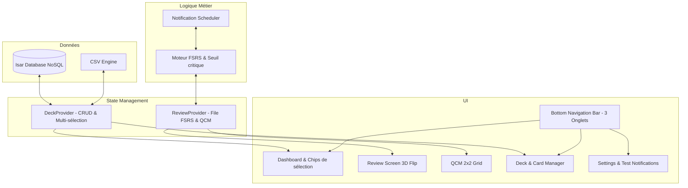

# Kawaii Flashcards ⚡ (L_E_A_R_N)

<p align="center">
  
</p>

<p align="center">
  <strong>Application mobile Flutter néo-brutaliste de révision par cartes mémoires avec répétition espacée FSRS, base Isar NoSQL, révision multi-paquets et import/export CSV sur-mesure.</strong>
</p>

<p align="center">
  <a href="https://github.com/Tahlasandale/L_E_A_R_N/releases/download/v1.0.0/Kawaii-Flashcards-v1.0.0.apk">
    
  </a>
</p>

<p align="center">
  
  
  
  
  
  
  
</p>

---

## 📱 Aperçu de l'Application

<table align="center">
  <tr>
    <td align="center"><strong>Tableau de Bord & Chips</strong></td>
    <td align="center"><strong>Révision Classique 3D Flip</strong></td>
  </tr>
  <tr>
    <td></td>
    <td></td>
  </tr>
  <tr>
    <td align="center"><strong>Mode Colles (QCM 2x2)</strong></td>
    <td align="center"><strong>Gestionnaire de Paquets</strong></td>
  </tr>
  <tr>
    <td></td>
    <td></td>
  </tr>
</table>

---

## ✨ Points Forts & Fonctionnalités

### 🗃️ Zéro Carte en Dur (Clean Slate)
L'application démarre vierge, sans aucune carte figée dans le code source. Vous créez et organisez librement vos propres paquets ou importez vos decks en un clic.

### 🧠 Moteur FSRS Adaptatif (Dual-Mode par Paquet)
Chaque paquet peut être configuré selon l'objectif de révision :
- **Mode Colles (Minutes)** : intervalles courts progressifs (1 min, 5 min, 10 min, 15 min...) conçus pour un entraînement intensif avant un examen ou une colle.
- **Mode Long Terme (Jours)** : répétition espacée FSRS standard pour ancrer les connaissances sur la durée.

### 📚 Révision Multi-Paquets & Urgence Unifiée
Sélectionnez en un instant un ou plusieurs paquets directement depuis l'écran d'accueil grâce aux **chips tactiles**. La file d'attente fusionne l'ensemble des cartes selon leur urgence FSRS (`dueDate`), avec option de mélange aléatoire global 🔀.

### 🃏 Révision Classique Hybride 3D
- Retournement fluide de la carte en 3D avec perspective tactile.
- **Tap n'importe où** sur l'écran pour retourner la carte.
- Notation au choix : 4 boutons tactiles (`😭 À revoir`, `🤔 Difficile`, `😊 Bien`, `🤩 Facile`) ou gestes de balayage direct (**Swipe gauche = À revoir**, **Swipe droite = Bien**).
- Requalification instantanée : une carte échouée est automatiquement replacée en fin de file pour la session en cours.

### 📝 Mode Colles (QCM Arcade 2x2)
- Affichage de la question avec police adaptative (auto-size).
- Grille de 2 colonnes x 2 lignes pour une ergonomie optimale au pouce.
- 4 choix uniques générés dynamiquement : 1 bonne réponse + 3 distracteurs tirés du paquet ou des autres paquets de la base en fallback.
- Feedback visuel instantané (vert pour une bonne réponse, rouge pour une erreur) et avance automatique.

### 🔋 Notifications Prédictives Zéro-Polling
Aucun service ne tourne en continu en arrière-plan. Lorsque l'application est mise en pause ou fermée, elle calcule dynamiquement l'instant exact où le seuil critique d'oubli FSRS sera atteint et planifie une notification locale précise (`flutter_local_notifications`).

### 📥 Import / Export CSV Personnalisé par Paquet
- Format 2 colonnes concis : `Question` et `Réponse` (cartes brutes sur une seule ligne).
- Délimiteurs de champ au choix : `,` (virgule), `;` (point-virgule), `\t` (tabulation), `|` (pipe).
- Import par collage de texte direct ou sélection de fichier `.csv` / `.txt`.
- Export et partage immédiat via la feuille native de partage.

### 🎨 Design Catppuccin Mocha & Retours Haptiques
- Palette officielle **Catppuccin Mocha** sombre avec typographie **Nunito**.
- Boutons néo-brutalistes 3D avec bordures épaisses et effet de pression physique.
- Mascottes textuelles réactives dans l'AppBar (`(◕‿◕)`, `(ง'̀-'́)ง`, `(*^‿^*)`, `\(^ヮ^)/`).
- 100% silencieux avec vibrations haptiques subtiles sur chaque interaction.

---

## 🏛️ Architecture Technique



---

## 🚀 Installation & Lancement

### 📦 Télécharger l'APK direct
Vous pouvez télécharger directement le binaire Android pré-compilé :  
👉 **[Télécharger Kawaii-Flashcards-v1.0.0.apk](https://github.com/Tahlasandale/L_E_A_R_N/releases/download/v1.0.0/Kawaii-Flashcards-v1.0.0.apk)**

### Cloner et compiler depuis les sources
```bash
git clone https://github.com/Tahlasandale/L_E_A_R_N.git
cd L_E_A_R_N
flutter pub get
```

### Lancer la suite de tests
```bash
flutter test
```
*Résultat : 23/23 tests réussis.*

### Lancer l'analyse statique
```bash
flutter analyze
```
*Résultat : No issues found!*

### Lancer l'application
```bash
flutter run
```

---

## 📄 Licence
Ce projet est distribué sous licence MIT.
