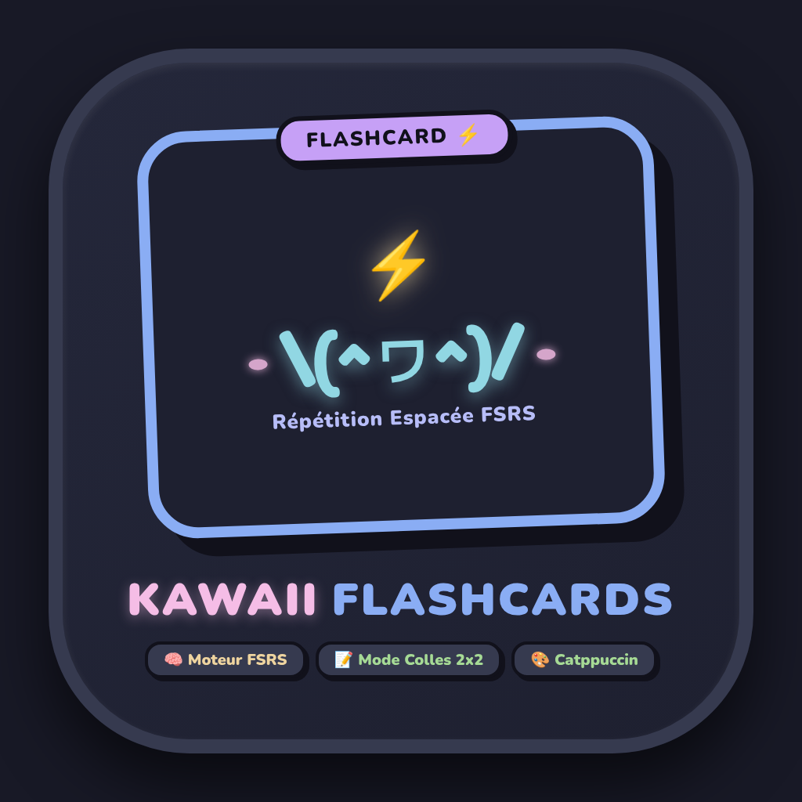
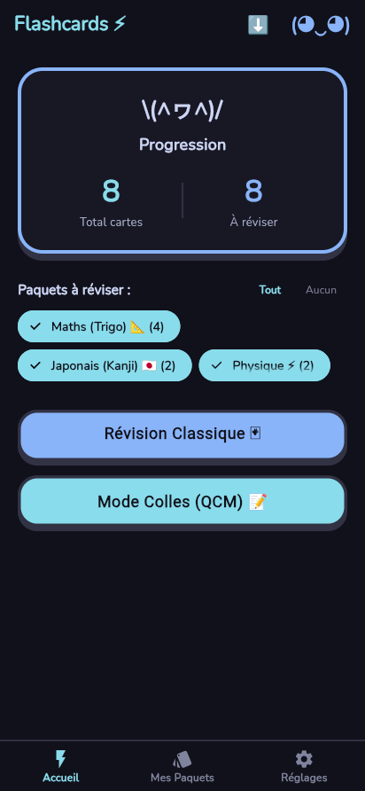
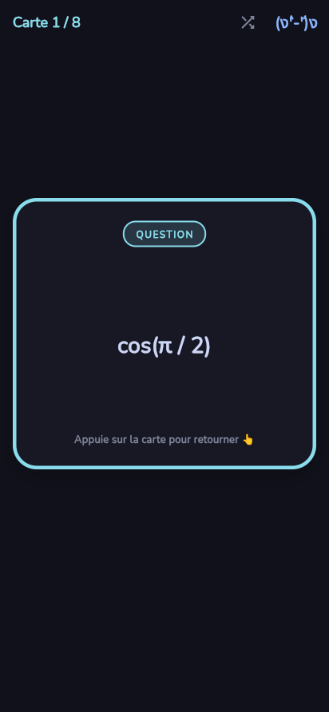
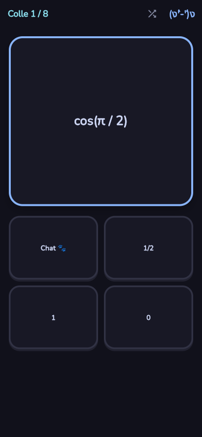
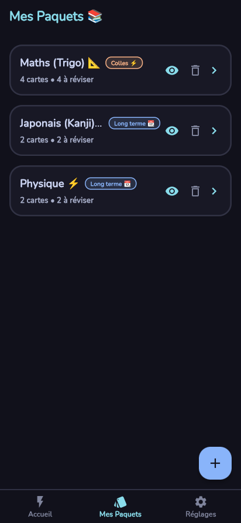
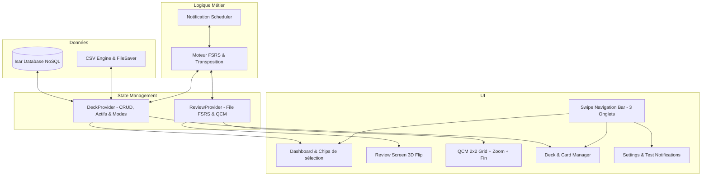

# Kawaii Flashcards ⚡ (L_E_A_R_N)

<p align="center">
  
</p>

<p align="center">
  <strong>Application mobile & web Flutter néo-brutaliste de révision par cartes mémoires avec répétition espacée FSRS, base Isar NoSQL, révision multi-paquets, mode Colles arcade 2x2 et import/export CSV sur-mesure.</strong>
</p>

<p align="center">
  <a href="https://github.com/Tahlasandale/L_E_A_R_N/releases/download/v1.0.0/Kawaii-Flashcards-v1.0.0.apk">
    
  </a>
</p>

<p align="center">
  
  
  
  
  
  
  
  
</p>

---

## 📱 Aperçu de l'Application

<table align="center">
  <tr>
    <td align="center"><strong>Tableau de Bord & Chips</strong></td>
    <td align="center"><strong>Révision Classique 3D Flip</strong></td>
  </tr>
  <tr>
    <td></td>
    <td></td>
  </tr>
  <tr>
    <td align="center"><strong>Mode Colles (QCM 2x2)</strong></td>
    <td align="center"><strong>Gestionnaire de Paquets</strong></td>
  </tr>
  <tr>
    <td></td>
    <td></td>
  </tr>
</table>

---

## ✨ Points Forts & Fonctionnalités

### 🗃️ Zéro Carte en Dur (Clean Slate)
L'application démarre vierge, sans aucune carte figée dans le code source. Vous créez et organisez librement vos propres paquets ou importez vos decks en un clic.

### 🧠 Moteur FSRS Adaptatif (Dual-Mode par Paquet)
Chaque paquet peut être configuré selon l'objectif de révision :
- **Mode Colles (Minutes)** : intervalles courts progressifs (1 min, 5 min, 10 min, 15 min...) conçus pour un entraînement intensif avant un examen ou une colle.
- **Mode Long Terme (Jours)** : répétition espacée FSRS standard pour ancrer les connaissances sur la durée.
- **Bascule instantanée & transposition mathématique FSRS** : passez un paquet d'un mode à l'autre en un tap. Le facteur de facilité `ease` acquis est préservé, et les intervalles/échéances sont intelligemment convertis !

### 💤 Gestion des Paquets Inactifs
Basculez n'importe quel paquet en statut *Inactif* en un clic :
- Les cartes inactives sont automatiquement exclues du compteur total, des cartes à réviser, des chips du tableau de bord et des rappels prédictifs FSRS.
- Les paquets inactifs restent consultables et réactivables à tout moment dans *Mes Paquets*.

### 📚 Révision Multi-Paquets & Urgence Unifiée
Sélectionnez en un instant un ou plusieurs paquets directement depuis l'écran d'accueil grâce aux **chips tactiles**. La file d'attente fusionne l'ensemble des cartes selon leur urgence FSRS (`dueDate`), avec option de mélange aléatoire global 🔀 commutable en direct depuis l'AppBar.

### 🃏 Révision Classique Hybride 3D
- Retournement fluide de la carte en 3D avec perspective tactile.
- **Tap n'importe où** sur l'écran pour retourner la carte.
- Notation au choix : 4 boutons tactiles (`😭 À revoir`, `🤔 Difficile`, `😊 Bien`, `🤩 Facile`) ou gestes de balayage direct (**Swipe gauche = À revoir**, **Swipe droite = Bien**).
- Requalification instantanée : une carte échouée est automatiquement replacée en fin de file pour la session en cours.
- Bouton de mélange aléatoire 🔀 directement accessible dans la barre d'en-tête.

### 📝 Mode Colles (QCM Arcade 2x2)
- **Animations fluides** : transitions de glissement et fondu lors du passage à la question suivante, et pop kawaii sur les réponses.
- **Multi-lignes adaptatif** : prise en charge automatique des questions longues sur plusieurs lignes sans texte tronqué.
- **Zoom au maintien long (Long-Press)** : maintenez appuyé sur n'importe quel choix pour l'afficher en grand format sur la partie basse de l'écran. Relâchez pour revenir instantanément à la grille 2x2 !
- **Écran de fin de session intégré** : résultat affiché directement dans l'écran avec score, pourcentage de réussite, mascotte festive et bouton de rejouabilité immédiate.

### 🔋 Notifications Prédictives Zéro-Polling
Aucun service ne tourne en continu en arrière-plan. Lorsque l'application est mise en pause ou fermée, elle calcule dynamiquement l'instant exact où le seuil critique d'oubli FSRS sera atteint (sur les paquets actifs) et planifie une notification locale précise (`flutter_local_notifications`).

### 📥 Import / Export CSV Multi-Séparateurs & Téléchargements
- **Format 2 colonnes concis** : `Question` et `Réponse` (cartes brutes sur une seule ligne).
- **Séparateur Question ↔ Réponse configurable** : virgule (`,`), point-virgule (`;`), tabulation (`\t`), pipe (`|`) ou chaîne personnalisée.
- **Séparateur entre Cartes configurable** : saut de ligne standard (`\n`), point-virgule (`;` - format exact du prototype web), double saut (`\n\n`), tabulation (`\t`), pipe (`|`) ou chaîne personnalisée.
- **Swipe de suppression gauche vers droite** : supprimez rapidement les cartes indésirables par un balayage naturel.
- **Double action à l'export** : choisissez entre *Partager via...* (feuille de partage native du système) ou *Enregistrer dans Téléchargements* (dossier Downloads ou téléchargement navigateur direct).

### 🎨 Design Catppuccin Macchiato & Retours Haptiques
- Palette officielle **Catppuccin Macchiato** sombre avec typographie **Nunito**.
- Boutons néo-brutalistes 3D avec bordures épaisses et effet de pression physique.
- Mascottes textuelles réactives dans l'AppBar (`(◕‿◕)`, `(ง'̀-'́)ง`, `(*^‿^*)`, `\(^ヮ^)/`).
- 100% silencieux avec vibrations haptiques subtiles sur chaque interaction.

---

## 🏛️ Architecture Technique



---

## 🚀 Installation & Lancement

### 📦 Télécharger l'APK direct
Vous pouvez télécharger directement le binaire Android pré-compilé :  
👉 **[Télécharger Kawaii-Flashcards-v1.0.0.apk](https://github.com/Tahlasandale/L_E_A_R_N/releases/download/v1.0.0/Kawaii-Flashcards-v1.0.0.apk)**

### Cloner et compiler depuis les sources
```bash
git clone https://github.com/Tahlasandale/L_E_A_R_N.git
cd L_E_A_R_N
flutter pub get
```

### Lancer la suite de tests
```bash
flutter test
```
*Résultat : 30/30 tests réussis.*

### Lancer l'analyse statique
```bash
flutter analyze
```
*Résultat : No issues found!*

### Compiler pour le Web
```bash
flutter build web --release
```

### Lancer l'application
```bash
flutter run
```

---

## 📄 Licence
Ce projet est distribué sous licence MIT.
